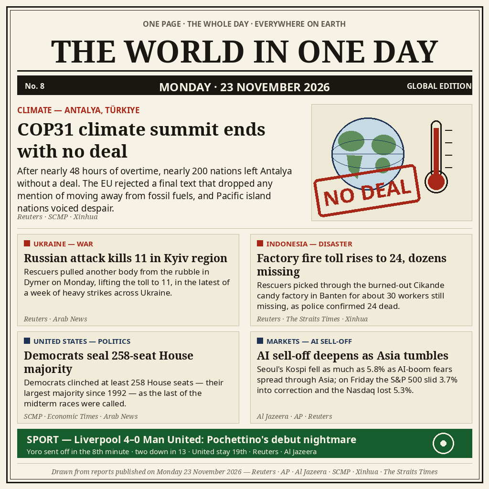

# The World in One Day — 23 November 2026

[](https://make.fun/bounty/news-image-20261123)
[](https://make.fun/bounty/news-image-20261123/leaderboard)
[](https://make.fun/bounty/news-image-20261123)

My entry for make.fun's news-image-20261123 contest: a single
1024×1024 front page that sums up the world news of **Monday,
23 November 2026**. A masthead and date band up top, one lead story
with a hand-drawn globe-and-thermometer illustration and a red
"NO DEAL" stamp, four panels beneath it, and a green sport banner
along the bottom. Every story was cross-checked against at least
two independent outlets reporting that day.



## The six stories

1. **COP31 climate summit ends with no deal** — After nearly 48
   hours of overtime in Antalya, nearly 200 nations left without a
   deal; the EU rejected a final text that dropped any mention of
   moving away from fossil fuels, and Pacific island nations voiced
   despair. *(Reuters · SCMP · Xinhua)*
2. **Russian attack kills 11 in Kyiv region** — Rescuers pulled
   another body from the rubble in Dymer, lifting the toll to 11,
   in the latest of a week of heavy strikes across Ukraine.
   *(Reuters · Arab News)*
3. **Factory fire toll rises to 24, dozens missing** — Rescuers
   searched the burned-out Cikande candy factory in Banten for
   about 30 workers still missing, as police confirmed 24 dead.
   *(Reuters · The Straits Times · Xinhua)*
4. **Democrats seal 258-seat House majority** — Democrats clinched
   at least 258 House seats, their largest majority since 1992, as
   the last of the midterm races were called.
   *(SCMP · Economic Times · Arab News)*
5. **AI sell-off deepens as Asia tumbles** — Seoul's Kospi fell as
   much as 5.8% as AI-boom fears spread through Asia; on Friday the
   S&P 500 slid 3.7% into correction and the Nasdaq lost 5.3%.
   *(Al Jazeera · AP · Reuters)*
6. **Liverpool 4–0 Man United** — Leny Yoro was sent off in the
   eighth minute and United were two down in 13 at Anfield, as
   Mauricio Pochettino's first match in charge ended in a rout.
   *(Reuters · Al Jazeera · Sky Sports)*

## How it is made

`entry.png` is drawn from scratch by `draw.py` (Python + Pillow,
flat vector shapes only — no photos, no downloaded assets) and
committed to this repository. `main.ts` (Node 22, standard library
only) copies the committed PNG to the output directory, so both
grader runs write byte-identical bytes:

```
mkdir -p out && MAKEFUN_OUTPUT_DIR=out node main.ts
```

To redraw the image: `python3 draw.py`.
